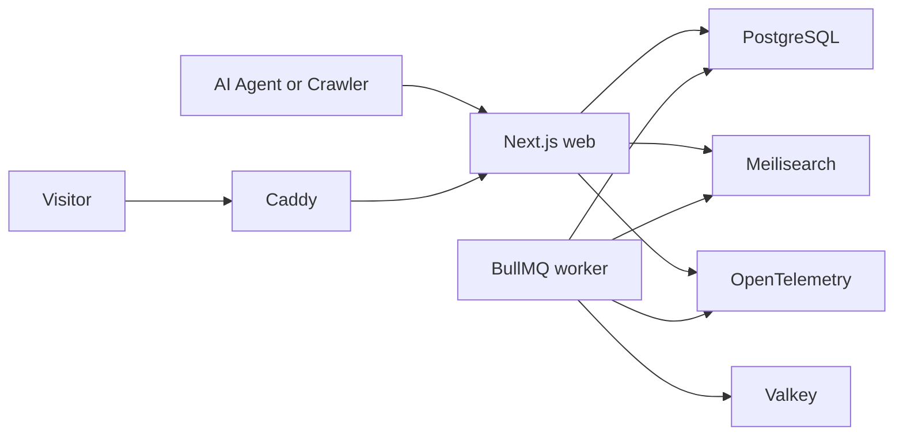

# Architecture

The repository is a `pnpm` workspace. `apps/web` serves the Next.js App Router site and machine-readable agent endpoints, while `apps/worker` owns background import and indexing jobs. Shared packages (`packages/domain`, `packages/config`, `packages/importer`, `packages/ui`) isolate validation, logging, crawler models, and design tokens.

> [!info] Module rule
> Callers interact through small, deep module interfaces (`searchCompanies`, `findCompanyByCui`, `getEditorialItems`, `normalizeLegacyRoute`) backed by Zod schemas. Database and crawler internals stay outside React page code.

## Runtime map

`docker-compose.yml` defines Caddy, `web`, `worker`, PostgreSQL, Valkey, Meilisearch, MinIO, and Mailpit. `docker-compose.observability.yml` adds OpenTelemetry Collector, Prometheus, Loki, Tempo, and Grafana. For fast local UI verification, `scripts/serve-mock.mjs` stages captured media from `reconstruction/offline-site/media/` into `apps/web/public/media/` and runs `@doingbusiness/web` on `http://localhost:3010/`.

The legacy catch-all route (`apps/web/app/[...legacy]/page.tsx`) keeps archived paths navigable while explicit route handlers serve `/robots.txt`, `/sitemap.xml`, `/llms.txt`, `/openapi.json`, and `/.well-known/api-catalog`. Interface rules live in [[Domain Schema]], visual rules live in [[Design]], and security rules live in [[Security and Privacy]].
