# Optimization comparison report

This report compares the legacy `doingbusiness.ro` website against the rebuilt local `http://localhost:3010` Next.js application across 19 route comparisons and 36 verified screenshots.

> [!info] Audit scope and artifact bundle
> Live origin probes confirmed Cloudflare Turnstile gating on `https://doingbusiness.ro/` without bypassing any challenge; legacy visuals come from `baseline/site/` (`docs/comparison-assets/live/`) and optimized visuals come from `http://localhost:3010/` (`docs/comparison-assets/local/`). Full print-ready exports live in [[DoingBusiness-Optimization-Comparison-Report.html]] and [[DoingBusiness-Optimization-Comparison-Report.pdf]].

## Executive summary metrics

| Dimension | Legacy doingbusiness.ro | Optimized localhost:3010 | Verified impact |
| --- | --- | --- | --- |
| Performance & Loading UX | Blocking #pageloader GIF (1,200ms delay + fadeOut), jQuery 3.6.1 / Bootstrap 3.4.1 scripts, external ad requests, 8,029px desktop scroll height. | Next.js App Router SSR with local next/font/google bundling, zero ad/tracker JS, GPU left-to-right skeleton shimmer (app/loading.tsx & .route-progress-fill), desktop scroll reduced to 6,970px. | Non-blocking first paint & LTR skeletons |
| Accessibility & Typography | Hidden 1px opacity:0.1 SEO <h1> on homepage, all-caps truncated titles, abrupt #c5020e red to #ff9800 orange navbar contrast drop on events, translucent mobile sidenav bleed-through. | Instrument Serif + Outfit + JetBrains Mono (tabular-nums), WCAG AA #18181B on #F8FAFC/#FFFFFF, #B45309 accent, skip link, 44px+ touch targets, opaque #3E4147 accordion drawer with Escape dismiss. | 0 broken images (0/515 vs 862 legacy audited) |
| Security & Turnstile Removal | Cloudflare Turnstile widget (sitekey 0x4AAAAAACmEIQOnZ5APK7Ty) injected on all rendered HTML routes; /top-companii/, /companii, and /companie/* return 0 bytes without cookie; 44 Revive Adserver slots across audited pages. | Zero Cloudflare Turnstile gates, zero Revive/AdOcean ad scripts, strict Zod runtime validation on /api/companies (400/200) and /api/contact (400/202), strict TS (no any/as/!) and security headers. | 0 Turnstile gates, 0 ad slots |
| Architecture & Hero Redesign | 2016 '24h News' float-based col-md-8/col-md-4 layout, 4-tier stacked header, commented-out <form id='contact-form'> on /contact/, broken Google Maps API referer box. | Google Stitch centered .hero-copy-panel flush-aligned (467.11px) with .hero-event-card, centered 1020px .hero-magazine-spotlight (MCR 2025 + PDF/CUI CTAs), 2-article asymmetric split + GPU VerticalSidebarCarousel, restored 202 Contact Form. | 19 routes / full functional parity |
| Agentic AI & Discovery APIs | /llms.txt, /openapi.json, /.well-known/api-catalog, and /sitemap.xml all return ~117 KB homepage HTML fallback; no JSON company search or Markdown content negotiation. | /llms.txt (12,867 B), /openapi.json (2,011 B, OpenAPI 3.1.0), /.well-known/api-catalog (598 B, RFC 9727), /robots.txt (AI bots), /sitemap.xml (14,162 B), Accept: text/markdown middleware, /api/companies JSON. | 100% agentic endpoints 200 OK |
| Mobile Responsiveness (390x844) | Broken Turnstile error widget above fold, mobile ad banner, 22,675px scroll height, translucent #mobile-nav overlay obscuring text. | Clean centered mobile Hero with .hero-mobile-strip thumbnails, 0px horizontal overflow, scroll height cut 41.7% to 13,214px, opaque accordion drawer with 2 expanded submenus. | 0px overflow, -41.7% mobile scroll |

## Agentic AI and API endpoint verification

| Endpoint | Legacy response | Optimized response | Observed behavior |
| --- | --- | --- | --- |
| `/llms.txt` | HTTP 200 (115.0 KB) - Returns full homepage HTML (<title>Acasa | DoingBusiness.ro</title>) fallback instead of text/plain llms.txt | HTTP 200 (text/markdown; charset=utf-8, 12.6 KB) | Structured Markdown catalog of navigation routes, machine-readable APIs, Romanian companies, and editorial highlights |
| `/openapi.json` | HTTP 200 (115.0 KB) - Returns full homepage HTML fallback instead of OpenAPI JSON specification | HTTP 200 (application/json, 2.0 KB) | Valid OpenAPI 3.1.0 specification covering /api/health, /api/companies, and /api/contact |
| `/.well-known/api-catalog` | HTTP 200 (115.0 KB) - Returns full homepage HTML fallback instead of RFC 9727 api-catalog linkset JSON | HTTP 200 (application/linkset+json; charset=utf-8, 598 B) | RFC 9727 linkset+json api-catalog pointing to /openapi.json and /llms.txt |
| `/robots.txt` | HTTP 200 (93 B) - Returns text/plain declaring Disallow: /admin/ and Sitemap: https://doingbusiness.ro/sitemap-index.xml | HTTP 200 (text/plain, 367 B) | Explicit Allow rules for Googlebot, GPTBot, ClaudeBot, PerplexityBot, and Sitemap reference |
| `/sitemap.xml` | HTTP 200 (115.1 KB) - Returns full homepage HTML fallback instead of XML sitemap (robots.txt declares /sitemap-index.xml) | HTTP 200 (application/xml, 13.8 KB) | Dynamic XML sitemap listing public routes, company profiles, and editorial articles |
| `/api/health` | Not available (0-byte Turnstile gate on /companii; commented-out form on /contact/) | HTTP 200 (application/json, 42 B) | Returns {"status":"ok","environment":"production"} |
| `/api/companies?q=OMV` | HTML only (no Accept: text/markdown negotiation) | HTTP 200 (application/json, 869 B) | Zod-validated JSON search returning matching company records (OMV Petrom, CUI 1590082, CAEN 0610) |
| `/api/companies?county=B&caen=0610` | HTML only (no Accept: text/markdown negotiation) | HTTP 200 (application/json, 869 B) | Combined county (judet) and 4-digit CAEN filtering returns 200 JSON |
| `/api/companies?caen=invalid` | HTML only (no Accept: text/markdown negotiation) | HTTP 400 (application/json, 138 B) | Zod validation rejects malformed CAEN parameter with 400 JSON fieldErrors |
| `/api/contact` | Not available (0-byte Turnstile gate on /companii; commented-out form on /contact/) | HTTP 202 (application/json, JSON) | POST validates payload via Zod: returns 400 on invalid input and 202 {"accepted":true} on valid structured submission |
| `/ (Accept: text/markdown)` | HTML only (no Accept: text/markdown negotiation) | HTTP 200 (text/markdown; charset=utf-8, 1.6 KB) | Middleware rewrites Accept: text/markdown requests to /api/markdown for agentic Markdown consumption (also verified on /companii) |
| `/dezvoltarea-afacerii` | HTML only (no Accept: text/markdown negotiation) | HTTP 200 (text/html; charset=utf-8, 39.8 KB) | Romanian alias route resolves cleanly with HTTP 200 |

## Route comparison index

| # | Route | Viewport | Legacy screenshot | Optimized screenshot | Key change summary |
| --- | --- | --- | --- | --- | --- |
| 1 | `/` | `1440x900` | `docs/comparison-assets/live/home-desktop.png` | `docs/comparison-assets/local/home-desktop.png` | Google Stitch centered .hero-copy-panel aligned flush (467.11px) alongside stretched .hero-event-card |
| 2 | `/#editorial-digest` | `1440x900 (scrolled to y=881)` | `docs/comparison-assets/live/home-editorial-desktop.png` | `docs/comparison-assets/local/home-editorial-desktop.png` | 2-article asymmetric editorial split (.editorial-asymmetric): 1 featured lead card alongside 2 stacked compact cards |
| 3 | `/` | `390x844` | `docs/comparison-assets/live/home-mobile.png` | `docs/comparison-assets/local/home-mobile.png` | Clean 390x844 mobile hero stack with .hero-mobile-strip thumbnails, centered copy, full-width touch CTAs, and 0px horizontal overflow |
| 4 | `/#mobile-menu` | `390x844 (modal drawer open)` | `docs/comparison-assets/live/mobile-modal-menu.png` | `docs/comparison-assets/local/mobile-modal-menu.png` | High-contrast opaque #site-sidenav-modal drawer with backdrop, Escape-key close handler, and aria-expanded accordion submenus (Linkleaders & Despre noi expanded) |
| 5 | `/editorial` | `1440x900` | `docs/comparison-assets/live/editorial.png` | `docs/comparison-assets/local/editorial.png` | Unified editorial portal grouping Interviuri, Leader Insights, Business Digest, and Stiri with breadcrumb PageHero |
| 6 | `/articole` | `1440x900` | `docs/comparison-assets/live/articole.png` | `docs/comparison-assets/local/articole.png` | 2-column modern editorial card grid with clean aspect-ratio covers and sidebar Webinarii/Articole widgets |
| 7 | `/stiri` | `1440x900` | `docs/comparison-assets/live/stiri.png` | `docs/comparison-assets/local/stiri.png` | Immediate above-the-fold news cards without 450px header/ad/Turnstile chrome overhead |
| 8 | `/interviuri` | `1440x900` | `docs/comparison-assets/live/interviuri.png` | `docs/comparison-assets/local/interviuri.png` | Sentence-case executive interview headlines replacing all-caps truncated legacy headlines |
| 9 | `/video-interviuri` | `1440x900` | `docs/comparison-assets/live/video-interviuri.png` | `docs/comparison-assets/local/video-interviuri.png` | Responsive Leader Insights video interview showcase with structured executive metadata |
| 10 | `/business-drive` | `1440x900` | `docs/comparison-assets/live/business-drive.png` | `docs/comparison-assets/local/business-drive.png` | Uniform object-cover automotive photography cards paired with sidebar editorial widgets |
| 11 | `/evenimente` | `1440x900` | `docs/comparison-assets/live/evenimente.png` | `docs/comparison-assets/local/evenimente.png` | Unified navigation chrome eliminating the abrupt legacy #ff9800 orange navbar contrast failure |
| 12 | `/webinarii` | `1440x900` | `docs/comparison-assets/live/webinarii.png` | `docs/comparison-assets/local/webinarii.png` | Accessible high-contrast header/body layout replacing orange low-contrast legacy shell |
| 13 | `/top-companii` | `1440x900` | `docs/comparison-assets/live/home-mcr-desktop.png` | `docs/comparison-assets/local/top-companii.png` | Replaces legacy 0-byte Turnstile-gated /top-companii/ response with full SSR Major Companies 2025 publication showcase |
| 14 | `/companii` | `1440x900` | `docs/comparison-assets/live/home-mcr-desktop.png` | `docs/comparison-assets/local/companii.png` | Interactive Zod-validated Romanian company directory (name/CUI/CAEN query, county/judet select, 4-digit CAEN select, turnover/employees/name sort) |
| 15 | `/despre-noi` | `1440x900` | `docs/comparison-assets/live/despre-noi.png` | `docs/comparison-assets/local/despre-noi.png` | Structured institutional overview with dedicated service links to /linkleaders and /business-development |
| 16 | `/linkleaders` | `1440x900` | `docs/comparison-assets/live/linkleaders.png` | `docs/comparison-assets/local/linkleaders.png` | Clean editorial service cards and structured media imagery replacing legacy &nbsp;-spaced wall of text |
| 17 | `/business-development` | `1440x900` | `docs/comparison-assets/live/business-development.png` | `docs/comparison-assets/local/business-development.png` | Structured B2B solution portfolio layout with dedicated /dezvoltarea-afacerii alias support (both 200 OK) |
| 18 | `/dezvoltarea-afacerii` | `1440x900` | `docs/comparison-assets/live/dezvoltarea-afacerii.png` | `docs/comparison-assets/local/business-development.png` | Romanian slug /dezvoltarea-afacerii verified HTTP 200 OK (40,707 bytes HTML) sharing the structured Business Development portfolio template. |
| 19 | `/contact` | `1440x900` | `docs/comparison-assets/live/contact.png` | `docs/comparison-assets/local/contact.png` | Restores full interactive Zod-validated ContactForm (Prenume, Nume, Email, Telefon, Companie, Pozitie, Mesaj) backed by POST /api/contact (400 invalid / 202 accepted) |

## Visual comparison by route

### 1. Homepage (Desktop Hero & Magazine Spotlight)

| Metric | Legacy doingbusiness.ro | Optimized localhost:3010 |
| --- | --- | --- |
| Route | `/` | `/` |
| Page title | Acasa | DoingBusiness.ro | DoingBusiness.ro | Solutii integrate B2B si Major Companies |
| HTTP status | 200 (115.1 KB origin) | 200 |
| Scroll height | 8,029px | 6,970px |
| Turnstile and ads | 1 Turnstile / 2 Revive slots | 0 Turnstile / 0 ad slots |
| Screenshot file | `docs/comparison-assets/live/home-desktop.png` (462.6 KB) | `docs/comparison-assets/local/home-desktop.png` (323.6 KB) |

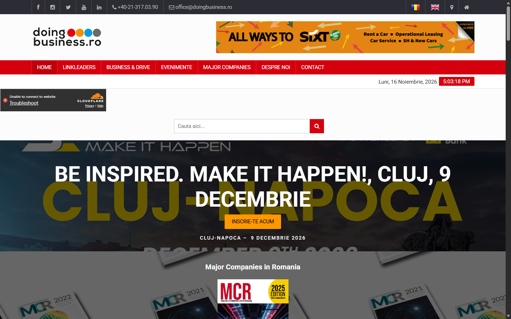

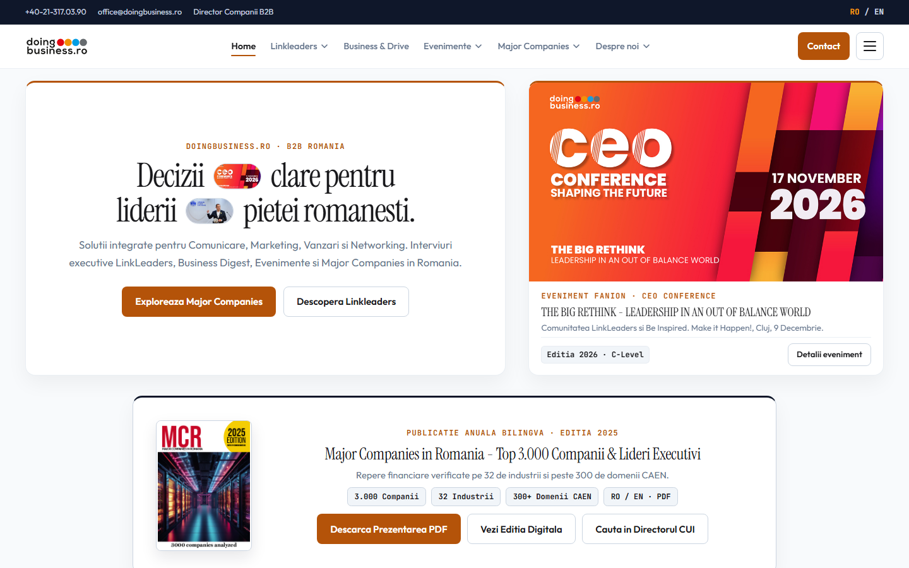

**Legacy drawbacks observed**
- Injects Cloudflare Turnstile script + #turnstile-widget directly in document flow
- Header contains 728x90 Revive Adserver banner alongside 4 stacked top-bar/nav/clock/search tiers
- Hidden 1px opacity:0.1 <h1> SEO hack; Major Companies Magazine spotlight pushed below full-bleed event parallax banner with tracked emailing redirect links
- Blocking #pageloader GIF overlay before content reveal

**Optimizations and new features shipped**
- Google Stitch centered .hero-copy-panel aligned flush (467.11px) alongside stretched .hero-event-card
- Centered .hero-magazine-spotlight below .hero-grid displaying Major Companies 2025 cover, JetBrains Mono stats, PDF download, digital edition, and CUI directory CTAs
- Single sticky glassmorphic header + dark #0F172A utility bar replacing 4-tier legacy header and 728x90 Revive ad banner
- Zero Cloudflare Turnstile widget, zero ad slots, zero broken images

### 2. Homepage (Asymmetric Editorial Split & Vertical Carousel)

| Metric | Legacy doingbusiness.ro | Optimized localhost:3010 |
| --- | --- | --- |
| Route | `/ (scrolled to STIRI & INTERVIURI)` | `/#editorial-digest` |
| Page title | Acasa | DoingBusiness.ro | DoingBusiness.ro | Solutii integrate B2B si Major Companies |
| HTTP status | 200 (115.1 KB origin) | 200 |
| Scroll height | 8,029px | 6,970px |
| Turnstile and ads | 1 Turnstile / 2 Revive slots | 0 Turnstile / 0 ad slots |
| Screenshot file | `docs/comparison-assets/live/home-editorial-desktop.png` (440.5 KB) | `docs/comparison-assets/local/home-editorial-desktop.png` (267.2 KB) |

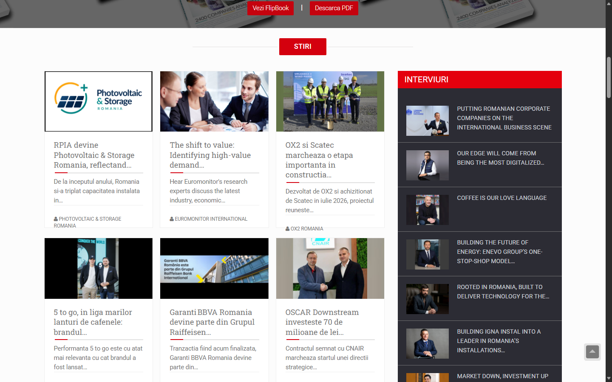

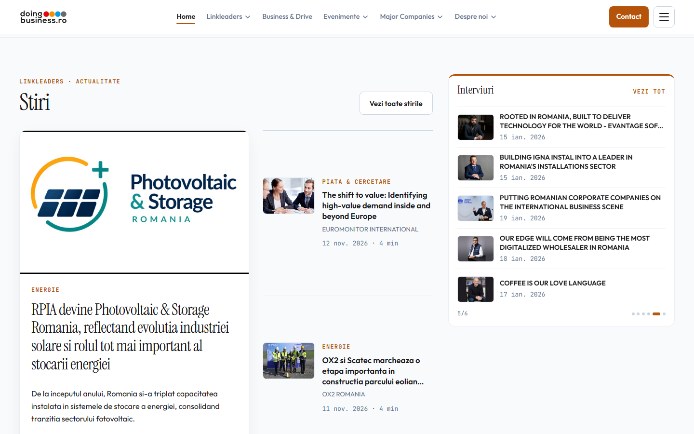

**Legacy drawbacks observed**
- Bootstrap col-md-8 3-column news grid with truncated ... titles next to high-contrast dark #262626 sidebar
- Fixed float grid layout without balanced asymmetric split or GPU-composited vertical carousels
- No progressive LTR skeleton loaders

**Optimizations and new features shipped**
- 2-article asymmetric editorial split (.editorial-asymmetric): 1 featured lead card alongside 2 stacked compact cards
- GPU-composited VerticalSidebarCarousel (Interviuri 5/6 indicator and progress dots) using translate3d with pause on hover/focus/reduced-motion
- Clean whitespace, Instrument Serif section titles, and JetBrains Mono metadata replacing dark #262626 legacy sidebar

### 3. Homepage (Mobile 390x844)

| Metric | Legacy doingbusiness.ro | Optimized localhost:3010 |
| --- | --- | --- |
| Route | `/` | `/` |
| Page title | Acasa | DoingBusiness.ro | DoingBusiness.ro | Solutii integrate B2B si Major Companies |
| HTTP status | 200 (115.1 KB origin) | 200 |
| Scroll height | 22,675px | 13,214px |
| Turnstile and ads | 1 Turnstile / 2 Revive slots | 0 Turnstile / 0 ad slots |
| Screenshot file | `docs/comparison-assets/live/home-mobile.png` (199.0 KB) | `docs/comparison-assets/local/home-mobile.png` (121.2 KB) |

**Legacy drawbacks observed**
- Broken Cloudflare Turnstile error box ('Unable to connect to website / Troubleshoot') renders prominently above the fold
- Mobile Revive Adserver banner and full-width search bar push primary content down on 22,675px-tall scroll page
- Tightly packed legacy icon-bar header without touch-friendly spacing

**Optimizations and new features shipped**
- Clean 390x844 mobile hero stack with .hero-mobile-strip thumbnails, centered copy, full-width touch CTAs, and 0px horizontal overflow
- Eliminates Cloudflare Turnstile error box, mobile ad banner, and reduces total page scroll height from 22,675px to 13,214px

### 4. Mobile Accordion Sidenav Drawer (390x844)

| Metric | Legacy doingbusiness.ro | Optimized localhost:3010 |
| --- | --- | --- |
| Route | `/ (mobile #sidenav-toggle open)` | `/#mobile-menu` |
| Page title | Acasa | DoingBusiness.ro | DoingBusiness.ro | Solutii integrate B2B si Major Companies |
| HTTP status | 200 (115.1 KB origin) | 200 |
| Scroll height | 844px | 13,214px |
| Turnstile and ads | 1 Turnstile / 2 Revive slots | 0 Turnstile / 0 ad slots |
| Screenshot file | `docs/comparison-assets/live/mobile-modal-menu.png` (109.2 KB) | `docs/comparison-assets/local/mobile-modal-menu.png` (33.5 KB) |

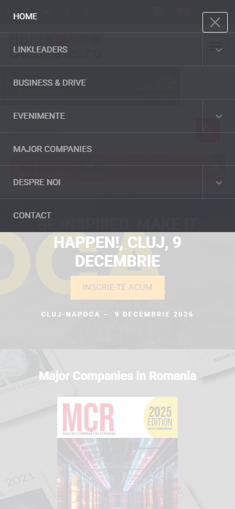

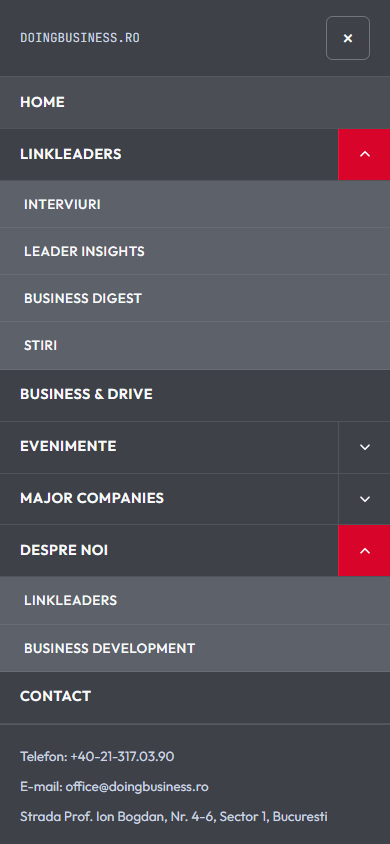

**Legacy drawbacks observed**
- Translucent jQuery sidenav drawer bleeds underlying hero typography and orange CTA through the menu backdrop
- Low text contrast and non-accessible focus management compared to opaque modal accordion drawer

**Optimizations and new features shipped**
- High-contrast opaque #site-sidenav-modal drawer with backdrop, Escape-key close handler, and aria-expanded accordion submenus (Linkleaders & Despre noi expanded)
- 44px+ touch targets and contact footer inside drawer, fixing legacy translucent overlay bleed-through

### 5. Linkleaders Editorial Hub (/editorial)

| Metric | Legacy doingbusiness.ro | Optimized localhost:3010 |
| --- | --- | --- |
| Route | `/editorial/` | `/editorial` |
| Page title | Toate editorialele | DoingBusiness.ro | Linkleaders · Editorial | DoingBusiness.ro |
| HTTP status | 200 (82.6 KB origin) | 200 |
| Scroll height | 5,383px | 5,803px |
| Turnstile and ads | 1 Turnstile / 3 Revive slots | 0 Turnstile / 0 ad slots |
| Screenshot file | `docs/comparison-assets/live/editorial.png` (378.6 KB) | `docs/comparison-assets/local/editorial.png` (255.3 KB) |

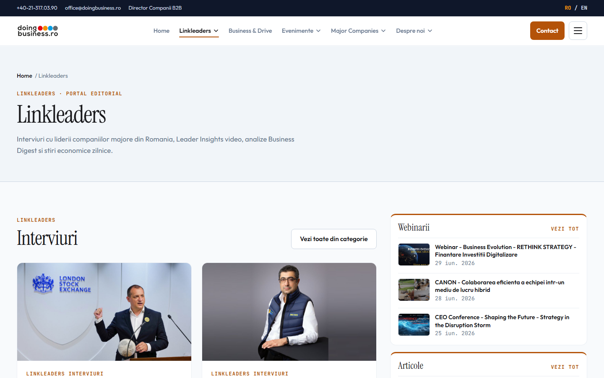

**Legacy drawbacks observed**
- Injects Cloudflare Turnstile widget and 3 Revive Adserver slots (728x90 header + sidebar banners)
- Generic 'Toate editorialele' title with truncated headlines and Bootstrap col-md-8/col-md-4 float layout

**Optimizations and new features shipped**
- Unified editorial portal grouping Interviuri, Leader Insights, Business Digest, and Stiri with breadcrumb PageHero
- Zero Revive Adserver banners or Turnstile blockers

### 6. Business Digest Articles (/articole)

| Metric | Legacy doingbusiness.ro | Optimized localhost:3010 |
| --- | --- | --- |
| Route | `/articole/` | `/articole` |
| Page title | Toate articolele | DoingBusiness.ro | Business Digest · Articole | DoingBusiness.ro |
| HTTP status | 200 (67.3 KB origin) | 200 |
| Scroll height | 3,595px | 3,203px |
| Turnstile and ads | 1 Turnstile / 3 Revive slots | 0 Turnstile / 0 ad slots |
| Screenshot file | `docs/comparison-assets/live/articole.png` (447.8 KB) | `docs/comparison-assets/local/articole.png` (375.7 KB) |

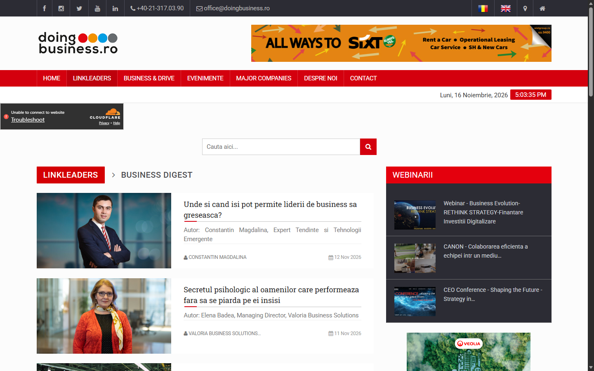

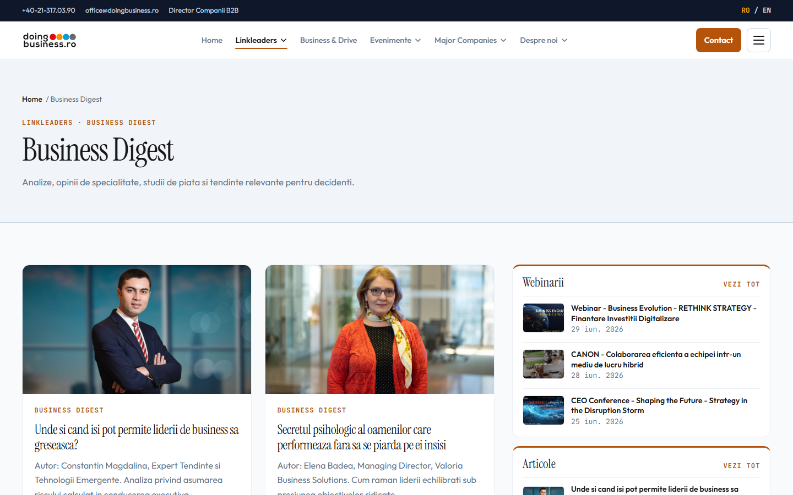

**Legacy drawbacks observed**
- Cloudflare Turnstile error banner and 3 Revive Adserver slots dominate upper viewport
- Static pagination without instant client filtering or LTR skeleton state

**Optimizations and new features shipped**
- 2-column modern editorial card grid with clean aspect-ratio covers and sidebar Webinarii/Articole widgets
- Supports Next.js loading.tsx LTR skeleton transitions and Accept: text/markdown negotiation

### 7. Business News Feed (/stiri)

| Metric | Legacy doingbusiness.ro | Optimized localhost:3010 |
| --- | --- | --- |
| Route | `/stiri/` | `/stiri` |
| Page title | Toate stirile | DoingBusiness.ro | Stiri · Business Digest | DoingBusiness.ro |
| HTTP status | 200 (67.3 KB origin) | 200 |
| Scroll height | 3,595px | 2,555px |
| Turnstile and ads | 1 Turnstile / 3 Revive slots | 0 Turnstile / 0 ad slots |
| Screenshot file | `docs/comparison-assets/live/stiri.png` (398.8 KB) | `docs/comparison-assets/local/stiri.png` (319.8 KB) |

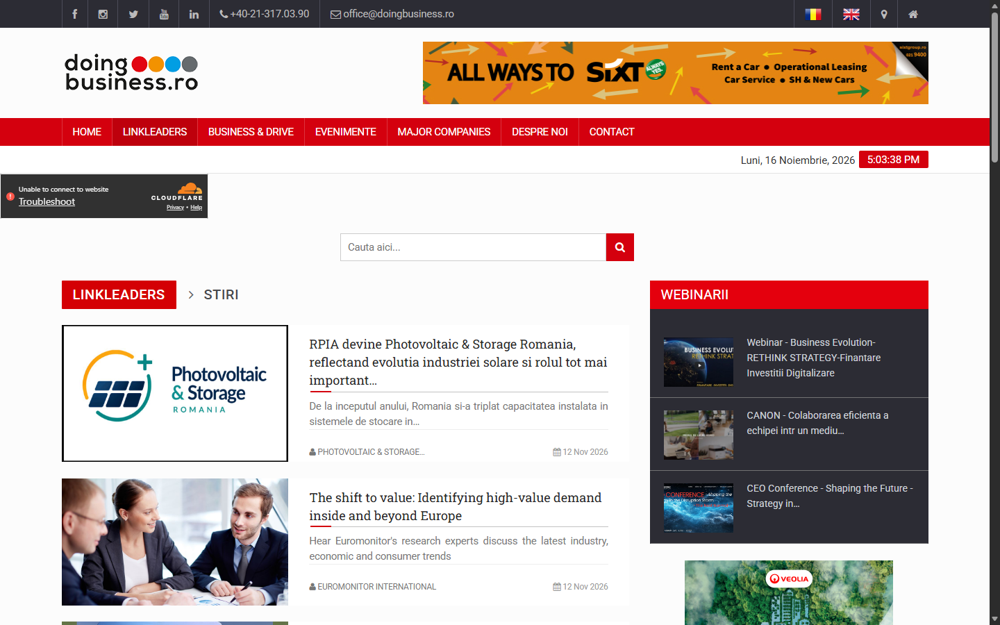

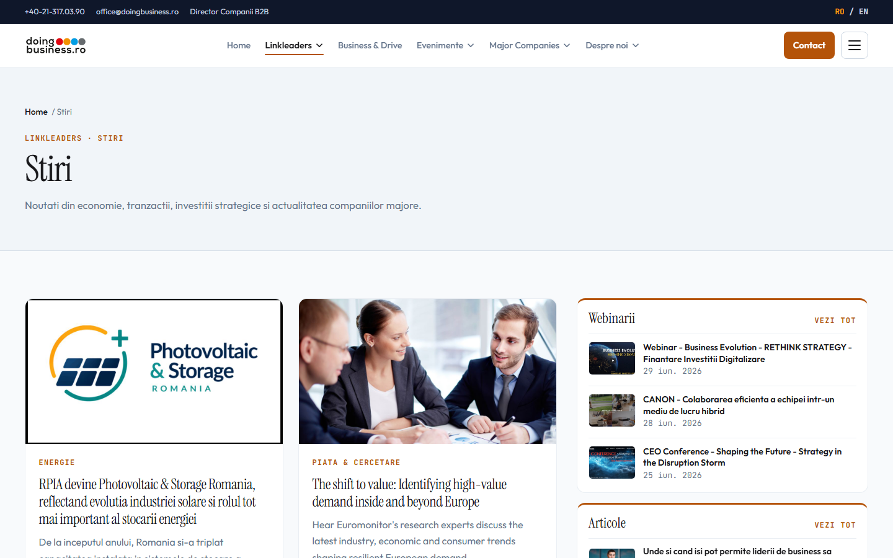

**Legacy drawbacks observed**
- Cloudflare Turnstile error banner and 3 Revive Adserver slots above/beside news list
- Repeated multi-tier header + unused search bar chrome consumes ~450px vertical space

**Optimizations and new features shipped**
- Immediate above-the-fold news cards without 450px header/ad/Turnstile chrome overhead
- Consistent typography hierarchy (Instrument Serif + Outfit + JetBrains Mono metadata)

### 8. LinkLeaders Executive Interviews (/interviuri)

| Metric | Legacy doingbusiness.ro | Optimized localhost:3010 |
| --- | --- | --- |
| Route | `/interviuri/` | `/interviuri` |
| Page title | Toate interviurile | DoingBusiness.ro | Interviuri · LinkLeaders | DoingBusiness.ro |
| HTTP status | 200 (65.9 KB origin) | 200 |
| Scroll height | 3,595px | 2,555px |
| Turnstile and ads | 1 Turnstile / 3 Revive slots | 0 Turnstile / 0 ad slots |
| Screenshot file | `docs/comparison-assets/live/interviuri.png` (379.4 KB) | `docs/comparison-assets/local/interviuri.png` (293.0 KB) |

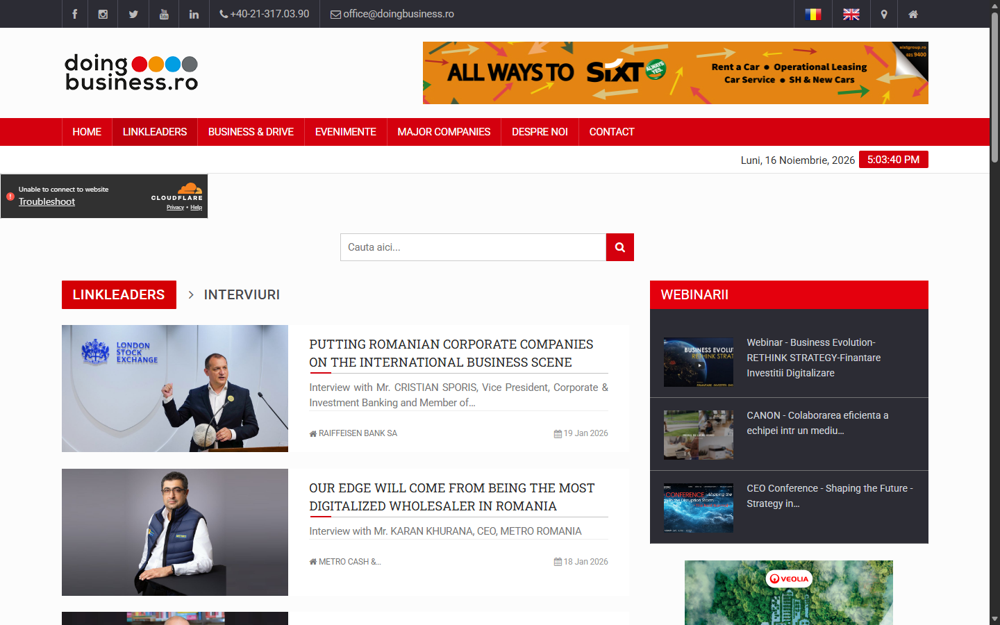

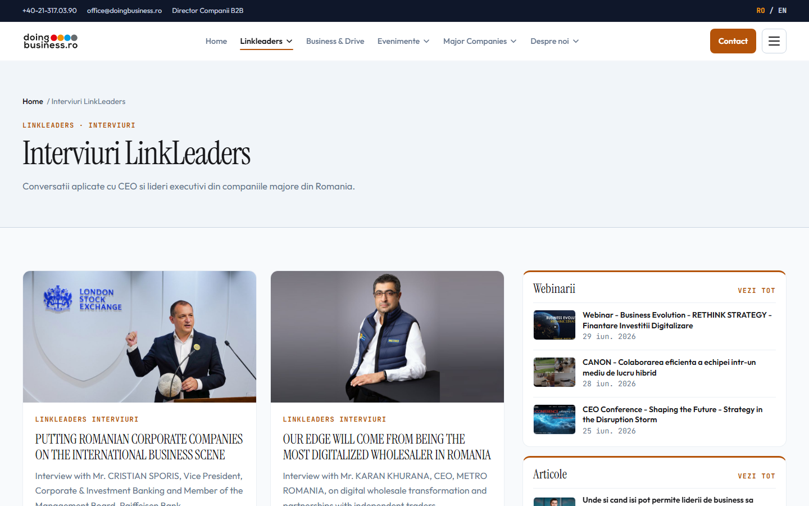

**Legacy drawbacks observed**
- All-caps truncated titles with ellipses and Turnstile + Revive ad overhead
- Rigid horizontal list items without modern editorial typography hierarchy

**Optimizations and new features shipped**
- Sentence-case executive interview headlines replacing all-caps truncated legacy headlines
- Clean editorial sidebar and zero ad/Turnstile interference

### 9. Leader Insights Video Interviews (/video-interviuri)

| Metric | Legacy doingbusiness.ro | Optimized localhost:3010 |
| --- | --- | --- |
| Route | `/video-interviuri/` | `/video-interviuri` |
| Page title | Toate video-interviurile | DoingBusiness.ro | Leader Insights · Interviuri video | DoingBusiness.ro |
| HTTP status | 200 (67.5 KB origin) | 200 |
| Scroll height | 3,595px | 2,484px |
| Turnstile and ads | 1 Turnstile / 3 Revive slots | 0 Turnstile / 0 ad slots |
| Screenshot file | `docs/comparison-assets/live/video-interviuri.png` (492.4 KB) | `docs/comparison-assets/local/video-interviuri.png` (455.0 KB) |

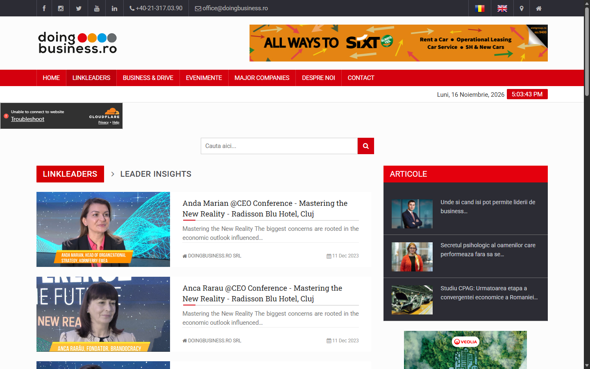

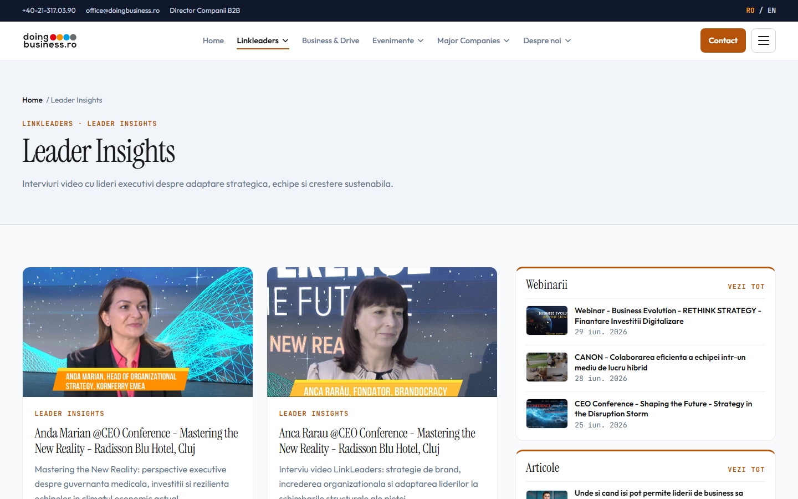

**Legacy drawbacks observed**
- Static thumbnails mixed with Revive ads and Turnstile widget
- No structured video schema or unified editorial card metadata

**Optimizations and new features shipped**
- Responsive Leader Insights video interview showcase with structured executive metadata
- Zero Revive Adserver or Turnstile scripts

### 10. Business & Drive Automotive (/business-drive)

| Metric | Legacy doingbusiness.ro | Optimized localhost:3010 |
| --- | --- | --- |
| Route | `/business-drive/` | `/business-drive` |
| Page title | Piata Auto | DoingBusiness.ro | Business & Drive | DoingBusiness.ro |
| HTTP status | 200 (66.4 KB origin) | 200 |
| Scroll height | 3,595px | 2,505px |
| Turnstile and ads | 1 Turnstile / 3 Revive slots | 0 Turnstile / 0 ad slots |
| Screenshot file | `docs/comparison-assets/live/business-drive.png` (402.5 KB) | `docs/comparison-assets/local/business-drive.png` (320.9 KB) |

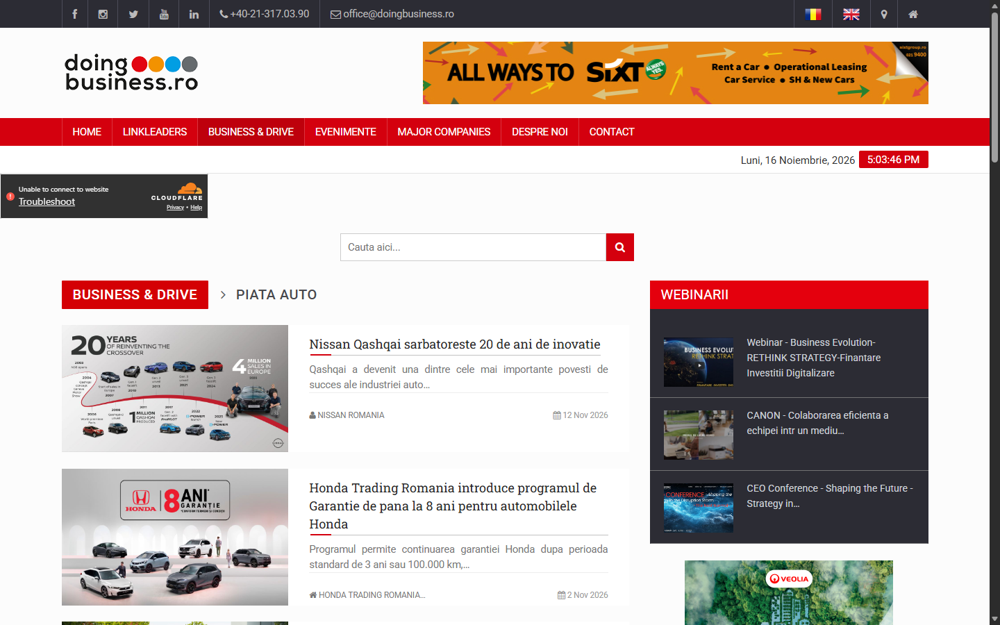

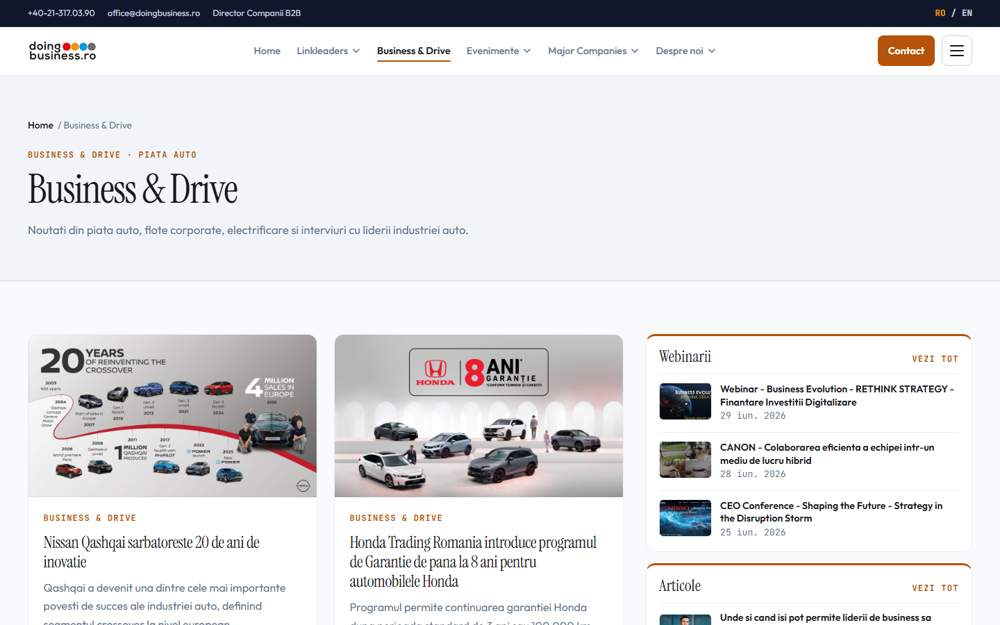

**Legacy drawbacks observed**
- Cloudflare Turnstile widget and 3 Revive Adserver ad containers
- Uncropped varied image ratios in rigid 24h News list cards

**Optimizations and new features shipped**
- Uniform object-cover automotive photography cards paired with sidebar editorial widgets
- Consistent WCAG AA surface contrast and zero external ad slots

### 11. Conferences & Events Portal (/evenimente)

| Metric | Legacy doingbusiness.ro | Optimized localhost:3010 |
| --- | --- | --- |
| Route | `/evenimente/` | `/evenimente` |
| Page title | Toate evenimentele | DoingBusiness.ro | Evenimente · CEO Conference & Business Evolution | DoingBusiness.ro |
| HTTP status | 200 (74.7 KB origin) | 200 |
| Scroll height | 4,222px | 3,510px |
| Turnstile and ads | 1 Turnstile / 3 Revive slots | 0 Turnstile / 0 ad slots |
| Screenshot file | `docs/comparison-assets/live/evenimente.png` (373.1 KB) | `docs/comparison-assets/local/evenimente.png` (255.1 KB) |

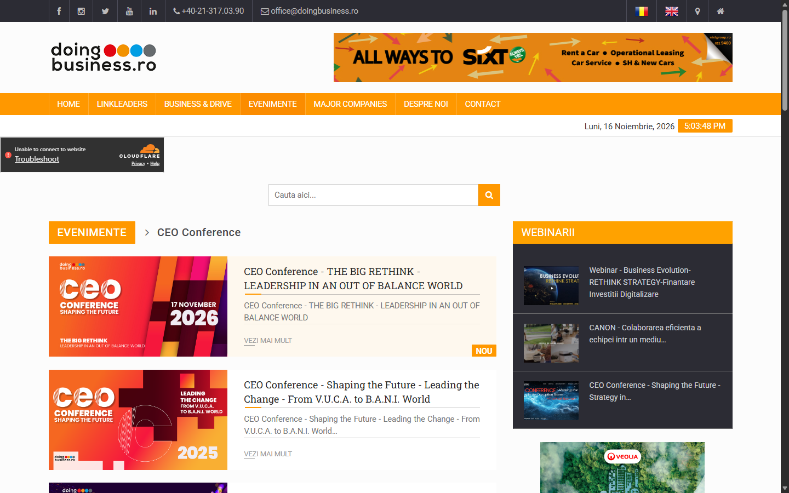

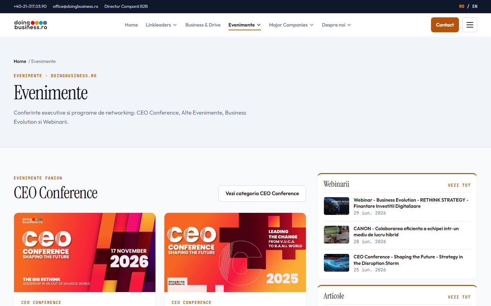

**Legacy drawbacks observed**
- Global navbar switches abruptly from #c5020e red to bright #ff9800 orange with low white-on-orange contrast
- Turnstile widget and Revive ad banners clutter event listings

**Optimizations and new features shipped**
- Unified navigation chrome eliminating the abrupt legacy #ff9800 orange navbar contrast failure
- Structured event sections for CEO Conference, Business Evolution, Alte Evenimente, and Webinarii

### 12. Executive Webinars (/webinarii)

| Metric | Legacy doingbusiness.ro | Optimized localhost:3010 |
| --- | --- | --- |
| Route | `/webinarii/` | `/webinarii` |
| Page title | Toate webinariile | DoingBusiness.ro | Webinarii · DoingBusiness.ro | DoingBusiness.ro |
| HTTP status | 200 (71.5 KB origin) | 200 |
| Scroll height | 3,998px | 2,484px |
| Turnstile and ads | 1 Turnstile / 3 Revive slots | 0 Turnstile / 0 ad slots |
| Screenshot file | `docs/comparison-assets/live/webinarii.png` (472.8 KB) | `docs/comparison-assets/local/webinarii.png` (416.2 KB) |

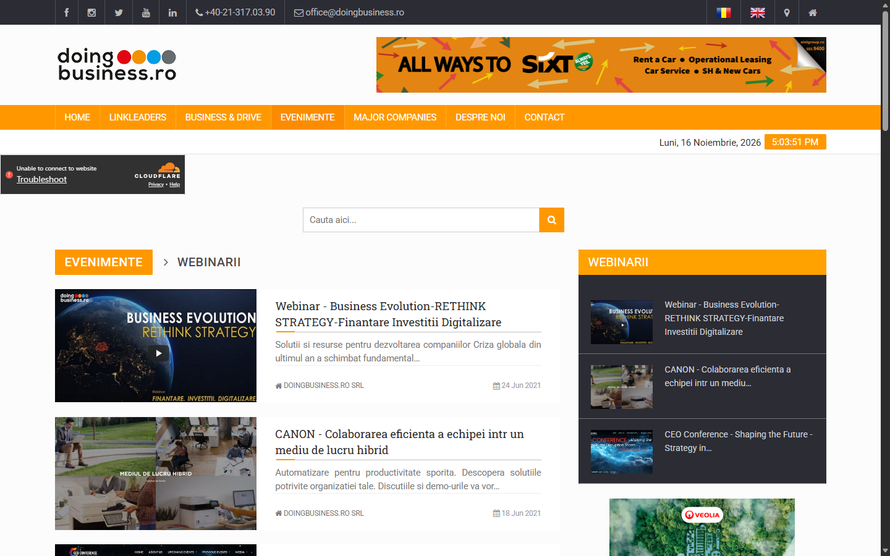

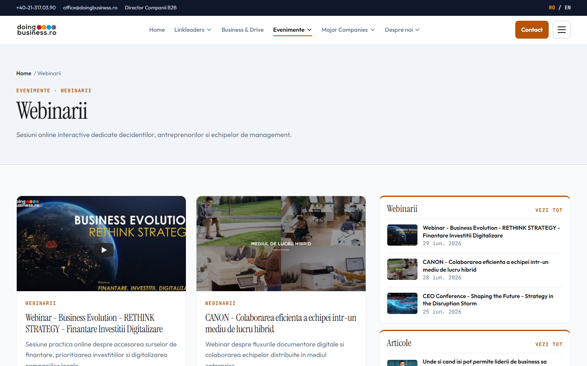

**Legacy drawbacks observed**
- Orange #ff9800 navbar theme shift with low contrast white links
- Revive Adserver banners and Turnstile script injection

**Optimizations and new features shipped**
- Accessible high-contrast header/body layout replacing orange low-contrast legacy shell
- Clean 2-column webinar archive with zero Revive ads or Turnstile scripts

### 13. Major Companies Publication (/top-companii)

| Metric | Legacy doingbusiness.ro | Optimized localhost:3010 |
| --- | --- | --- |
| Route | `/top-companii/` | `/top-companii` |
| Page title | Acasa | DoingBusiness.ro (Major Companies section; /top-companii/ returned 0 bytes) | Major Companies in Romania | DoingBusiness.ro |
| HTTP status | 200 (0 B origin) | 200 |
| Scroll height | 8,029px | 3,498px |
| Turnstile and ads | 1 Turnstile / 2 Revive slots | 0 Turnstile / 0 ad slots |
| Screenshot file | `docs/comparison-assets/live/home-mcr-desktop.png` (135.3 KB) | `docs/comparison-assets/local/top-companii.png` (257.6 KB) |

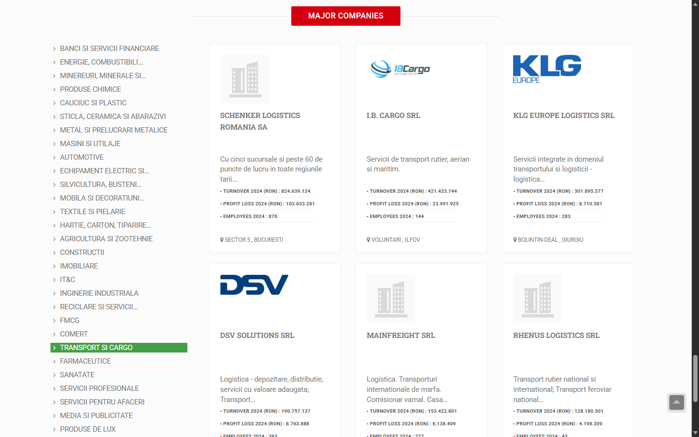

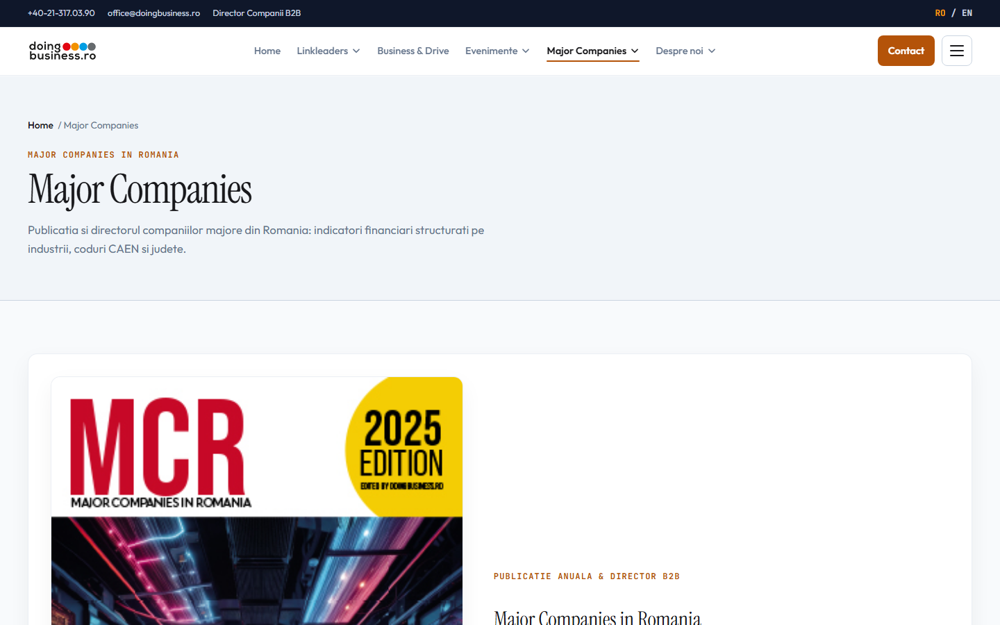

**Legacy drawbacks observed**
- Dedicated /top-companii/, /major-companies/, /top-companii/abrazivi/, /companie/*, and /companii endpoints return HTTP 200 with 0-byte empty body without a Turnstile verification cookie (observed both live on 2026-11-16 and in baseline/site/top-companii/index.html SHA-256 e3b0c44...)
- Un-gated homepage Major Companies block (home-mcr-desktop.png) offers only a flat 32-industry list with zero CUI, CAEN, county (judet), or financial metric search filters
- Relies on generic nocompany.png building icons and truncated text

**Optimizations and new features shipped**
- Replaces legacy 0-byte Turnstile-gated /top-companii/ response with full SSR Major Companies 2025 publication showcase
- Direct PDF download (/media/downloads/2024/Major-Companies-in-Romania-2024-fp.pdf), industry pills, and deep links into /companii

### 14. Interactive CUI / CAEN / County Directory (/companii)

| Metric | Legacy doingbusiness.ro | Optimized localhost:3010 |
| --- | --- | --- |
| Route | `/companii (Turnstile 0-byte gate; homepage MCR fallback)` | `/companii` |
| Page title | 0-Byte Empty Response (/companii & /top-companii/ gated) | Director companii | DoingBusiness.ro |
| HTTP status | 200 (0 B origin) | 200 |
| Scroll height | 8,029px | 2,625px |
| Turnstile and ads | 1 Turnstile / 2 Revive slots | 0 Turnstile / 0 ad slots |
| Screenshot file | `docs/comparison-assets/live/home-mcr-desktop.png` (135.3 KB) | `docs/comparison-assets/local/companii.png` (97.5 KB) |

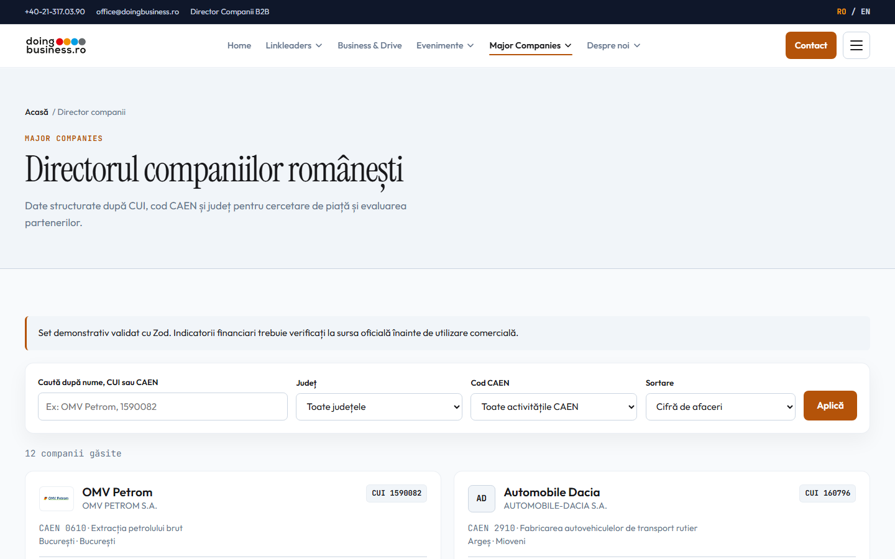

**Legacy drawbacks observed**
- Live /companii, /top-companii/, /major-companies/, and /companie/* return HTTP 200 with 0 bytes without a Turnstile cookie.
- Un-gated homepage Major Companies block exposes only a flat 32-industry list with nocompany.png placeholders and zero CUI, CAEN, or county search controls.

**Optimizations and new features shipped**
- Interactive Zod-validated Romanian company directory (name/CUI/CAEN query, county/judet select, 4-digit CAEN select, turnover/employees/name sort)
- URL query synchronization + /api/companies JSON backend + JetBrains Mono CUI badges + copy-CUI action + clean monogram fallbacks

### 15. Institutional Overview (/despre-noi)

| Metric | Legacy doingbusiness.ro | Optimized localhost:3010 |
| --- | --- | --- |
| Route | `/despre-noi/` | `/despre-noi` |
| Page title | Despre noi | DoingBusiness.ro | Despre noi | DoingBusiness.ro |
| HTTP status | 200 (27.5 KB origin) | 200 |
| Scroll height | 1,920px | 2,440px |
| Turnstile and ads | 1 Turnstile / 2 Revive slots | 0 Turnstile / 0 ad slots |
| Screenshot file | `docs/comparison-assets/live/despre-noi.png` (252.6 KB) | `docs/comparison-assets/local/despre-noi.png` (85.2 KB) |

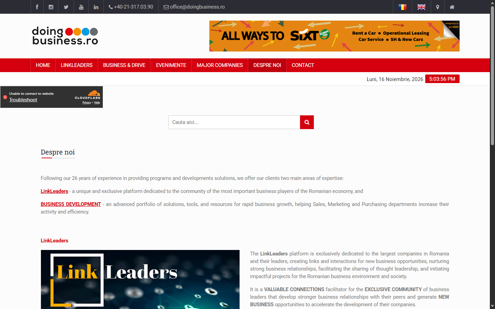

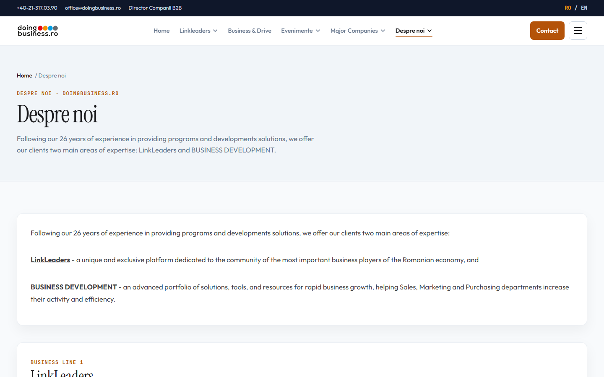

**Legacy drawbacks observed**
- Mixes Romanian navigation/heading ('Despre noi') with English body copy inside .contact-us form-group wrappers
- Turnstile widget and Revive Adserver header banner present on institutional about page

**Optimizations and new features shipped**
- Structured institutional overview with dedicated service links to /linkleaders and /business-development
- Eliminates legacy .contact-us form-group hacks, Turnstile widget, and Revive ad banners

### 16. LinkLeaders Program (/linkleaders)

| Metric | Legacy doingbusiness.ro | Optimized localhost:3010 |
| --- | --- | --- |
| Route | `/linkleaders/` | `/linkleaders` |
| Page title | LinkLeaders | DoingBusiness.ro | LinkLeaders | DoingBusiness.ro |
| HTTP status | 200 (34.7 KB origin) | 200 |
| Scroll height | 5,383px | 4,050px |
| Turnstile and ads | 1 Turnstile / 2 Revive slots | 0 Turnstile / 0 ad slots |
| Screenshot file | `docs/comparison-assets/live/linkleaders.png` (350.3 KB) | `docs/comparison-assets/local/linkleaders.png` (301.4 KB) |

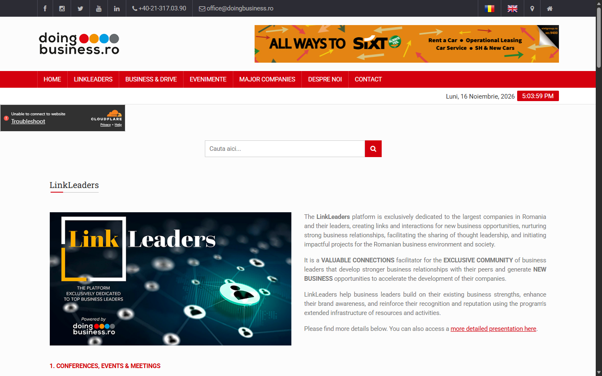

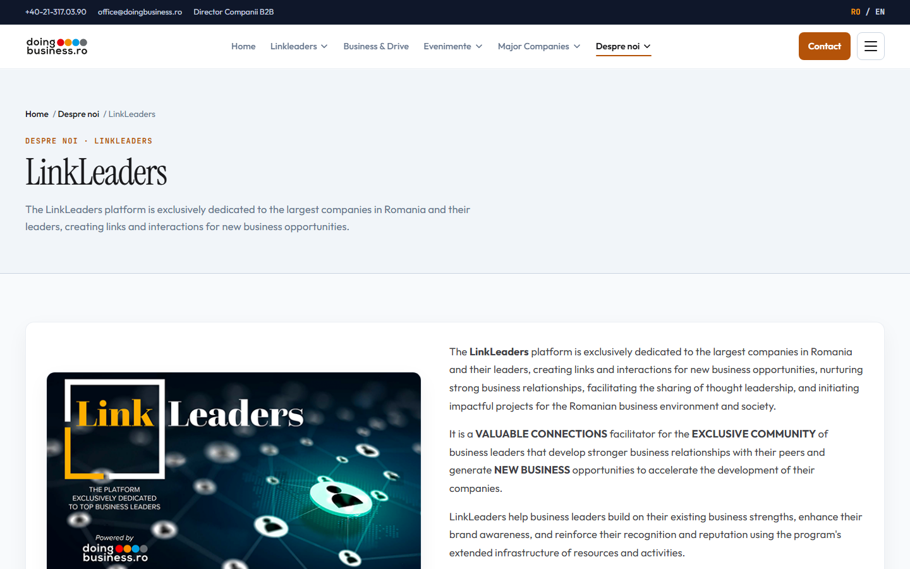

**Legacy drawbacks observed**
- Long unformatted wall of Bootstrap .col-md-12/.form-group text with &nbsp; spacers
- Turnstile error banner and Revive Adserver banner above content

**Optimizations and new features shipped**
- Clean editorial service cards and structured media imagery replacing legacy &nbsp;-spaced wall of text
- Zero Turnstile or ad blockers

### 17. Business Development Portfolio (/business-development)

| Metric | Legacy doingbusiness.ro | Optimized localhost:3010 |
| --- | --- | --- |
| Route | `/business-development/` | `/business-development` |
| Page title | Business Development | DoingBusiness.ro | Business Development | DoingBusiness.ro |
| HTTP status | 200 (40.4 KB origin) | 200 |
| Scroll height | 7,728px | 4,768px |
| Turnstile and ads | 1 Turnstile / 2 Revive slots | 0 Turnstile / 0 ad slots |
| Screenshot file | `docs/comparison-assets/live/business-development.png` (359.5 KB) | `docs/comparison-assets/local/business-development.png` (308.4 KB) |

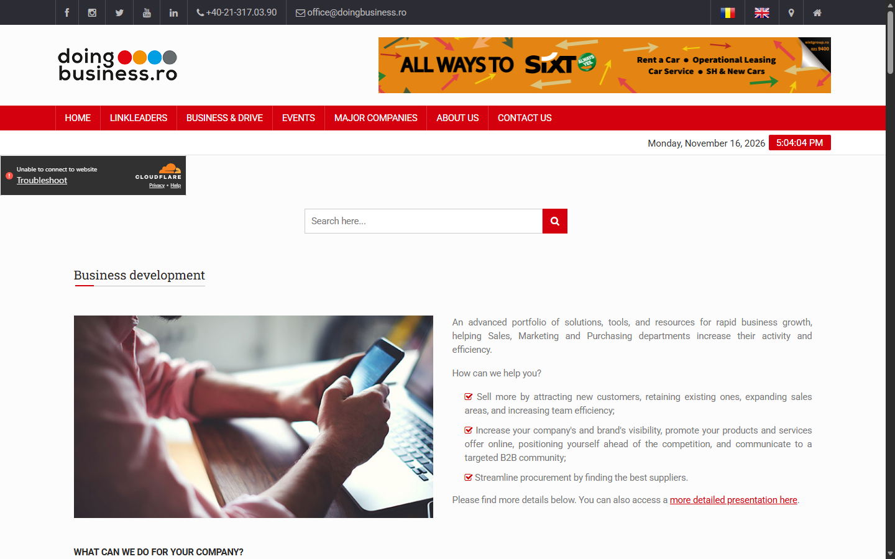

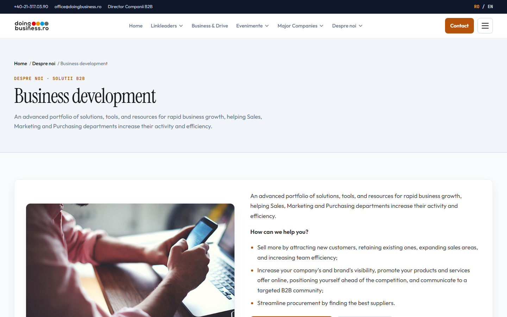

**Legacy drawbacks observed**
- Duplicate 7,728px page structure with Turnstile widget and Revive Adserver tags
- Dense list markup inside .contact-us container without visual hierarchy or CTA cards

**Optimizations and new features shipped**
- Structured B2B solution portfolio layout with dedicated /dezvoltarea-afacerii alias support (both 200 OK)
- Readable measure, visual cards, and clean CTA architecture replacing 7,728px unsegmented legacy scroll

### 18. Romanian Business Development Alias (/dezvoltarea-afacerii)

| Metric | Legacy doingbusiness.ro | Optimized localhost:3010 |
| --- | --- | --- |
| Route | `/dezvoltarea-afacerii/` | `/dezvoltarea-afacerii` |
| Page title | Business Development | DoingBusiness.ro | Business Development (Romanian Route Alias) | DoingBusiness.ro |
| HTTP status | 200 (40.5 KB origin) | 200 |
| Scroll height | 7,728px | 4,768px |
| Turnstile and ads | 1 Turnstile / 2 Revive slots | 0 Turnstile / 0 ad slots |
| Screenshot file | `docs/comparison-assets/live/dezvoltarea-afacerii.png` (358.2 KB) | `docs/comparison-assets/local/business-development.png` (308.4 KB) |

**Legacy drawbacks observed**
- Romanian slug /dezvoltarea-afacerii/ renders English copy ('Business development') inside Romanian navigation shell
- Turnstile widget, Revive ad banner, and 7,728px unsegmented text scroll

**Optimizations and new features shipped**
- Romanian slug /dezvoltarea-afacerii verified HTTP 200 OK (40,707 bytes HTML) sharing the structured Business Development portfolio template.
- Consistent navigation chrome, readable typographic measure, and PDF capability decks replacing 7,728px unsegmented legacy scroll.

### 19. Contact Information & Validated Form (/contact)

| Metric | Legacy doingbusiness.ro | Optimized localhost:3010 |
| --- | --- | --- |
| Route | `/contact/` | `/contact` |
| Page title | Contact | DoingBusiness.ro | Contact | DoingBusiness.ro |
| HTTP status | 200 (31.7 KB origin) | 200 |
| Scroll height | 1,480px | 1,826px |
| Turnstile and ads | 1 Turnstile / 2 Revive slots | 0 Turnstile / 0 ad slots |
| Screenshot file | `docs/comparison-assets/live/contact.png` (134.4 KB) | `docs/comparison-assets/local/contact.png` (83.6 KB) |

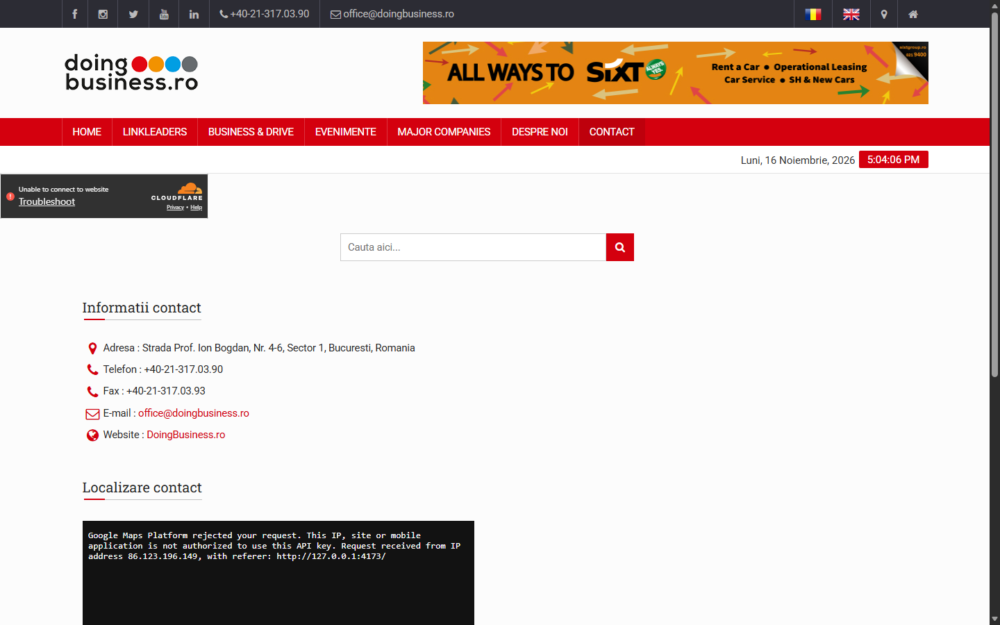

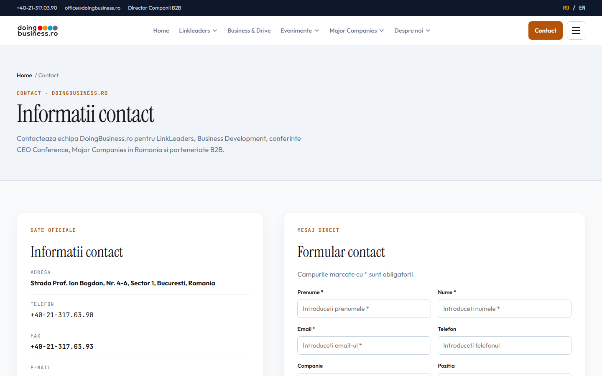

**Legacy drawbacks observed**
- Entire <form id='contact-form'> (lines 371-439 of baseline/site/contact/index.html) is commented out in HTML, leaving zero interactive inquiry form or validation
- Embedded Google Maps iframe fails off-origin with 'Google Maps Platform rejected your request' API key referer error
- Right half of the 2-column grid sits completely empty while Turnstile + Revive ad banners render above

**Optimizations and new features shipped**
- Restores full interactive Zod-validated ContactForm (Prenume, Nume, Email, Telefon, Companie, Pozitie, Mesaj) backed by POST /api/contact (400 invalid / 202 accepted)
- Removes broken off-origin Google Maps iframe error, Turnstile widget, and Revive ad banners

## Linked vault architecture

Audit manifests captured at `2026-11-16T15:06:00Z` (legacy) and `2026-11-16T15:23:23Z` (local). See [[plan]], [[Design]], [[Architecture]], [[Mobile Marketing UX]], [[Performance and Optimization]], and [[Security and Privacy]] for implementation details.
