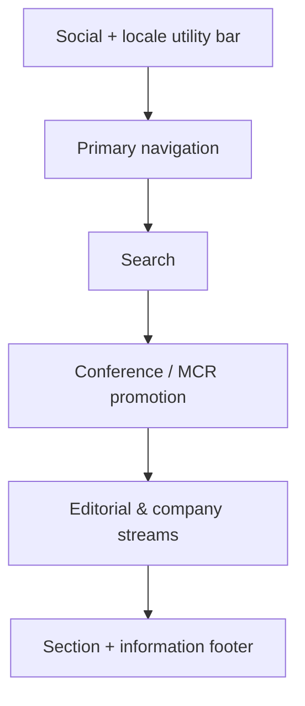

# Reconstruction Evidence

## Capture ledger

| Observation | Evidence | Confidence |
| --- | --- | --- |
| Page identity | Browser title: `Acasa \| DoingBusiness.ro`; URL: `https://doingbusiness.ro/` | High |
| Navigation | Top-level items: Home, LinkLeaders, Business & Drive, Evenimente, Major Companies, Despre noi, Contact | High |
| Homepage content model | News, interviews, business digest, articles, business & drive, interviews, major companies, section footer | High |
| Styling system | Bootstrap 3.4.1, jQuery UI 1.13.2, local `main.css`, `style.css`, `colors.css`, `responsive.css` | High |
| Assets exported | 72 downloaded assets: 64 images, 6 stylesheets, 1 font, and 1 Google Fonts stylesheet; plus 7 same-origin scripts downloaded to `offline-site` | High |

## Observed structure

## Asset handling

The browser-exported assets are preserved without renaming in `reference-assets/`; `manifest.json` maps each exported filename to its original URL. Same-origin files needed by the static page are also placed beneath `offline-site/` at their original path shape.

> [!note]
> Two Google-hosted font binaries could not be exported by the browser's asset bundler. The local Font Awesome font was captured. Browser fallbacks will handle unavailable Google font requests.

## Limitations and unknowns

- The REA MCP server was not registered for this session, so no REA Evidence IDs or AgentEnv bundle could be created. Browser capture and local file manifests are the retained evidence for this pass.
- The dynamic homepage content is time-sensitive. This snapshot reflects 15 November 2026 and is intentionally not described as a complete archive of the public site.
- No authenticated, write, payment, consent, or CAPTCHA flows were performed.
- Server routes, database schemas, search behavior, cookie implementation, advertising delivery, and third-party analytics remain unknown from this static capture.

## Optimization handoff

The official `mattpocock-skills` Codex plugin was installed from the `mattpocock` marketplace. It becomes available in the next agent turn. Start with an explicit spec for the desired modernized experience; do not optimize by changing uncaptured behavior.

See [[DoingBusiness.ro Local Reconstruction]] for local run instructions.

## Full public mirror capture

The sitemap crawl and linked-page capture completed on 15 November 2026. The machine-readable route and asset manifest is at `../baseline/reports/route-manifest.json`, and the Obsidian summary is at `../baseline/reports/Capture Report.md`.

- Sitemap locations declared: 19,151
- Captured route records: 65,691
- First-party assets localized: 12,245
- Recorded fetch, content-type, or Windows path failures: 287

> [!warning] Check the failure ledger
> The mirror contains every sitemap location, but a small set of routes or linked files failed capture or returned a non-HTML response. Review the manifest's `failures` array before treating every route as complete.
